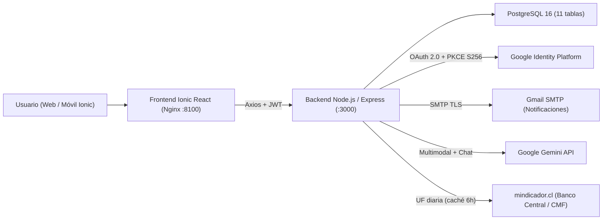

# Baúl Eterno — Plataforma Full Stack de Resguardo de Legado Personal

Plataforma web y móvil híbrida para el resguardo seguro de pólizas de seguro, inventario digital/patrimonial, cartas póstumas cifradas y protocolos de contingencia familiar, desarrollada con **Ionic 9 + React 19 + TypeScript**, **Node.js + Express 5**, **PostgreSQL** y orquestada con **Docker Compose**.

> **Asignatura:** Ingeniería Web y Móvil  
> **Proyecto:** Baúl Eterno  
> **Prototipo UI/UX:** [Prototipo interactivo en Figma](https://www.figma.com/proto/s6G2EQV48I6itrofIrnfEL/Baul-Eterno?node-id=0-1&t=US5Hg77S9L3U4a1T-1)  
> **Repositorio público:** [GitHub — FabianMaulen/Ingenieria-WEB-Y-MOVIL](https://github.com/FabianMaulen/Ingenieria-WEB-Y-MOVIL)

---

## 1. Integrantes y distribución de responsabilidades

| Integrante | Responsabilidades principales |
|---|---|
| **Fabián Alejandro Maulén González** | Arquitectura Full Stack, API REST Express/PostgreSQL, seguridad (JWT, OAuth 2.0 + PKCE, AES-256), motor de vigilancia/SMTP, integraciones externas (Gemini IA, UF), pruebas automatizadas y despliegue Docker. |
| **Ivan Moises Ferreira** | Modelado relacional PostgreSQL, diseño y validación de endpoints CRUD (pólizas, inventario, albaceas), colección Postman y pruebas funcionales. |
| **Dania Ahuelican Calvario** | Diseño UI/UX en Figma (web y móvil), caracterización de usuarios/proto-personas, componentes Ionic React y validaciones visuales de formularios. |
| **Mariana Belén Llime Muñoz** | Arquitectura de navegación móvil/web, documentación técnica de requerimientos (RF/RNF), flujos de albacea/guía de cobro y pruebas de usabilidad. |

---

## 2. Problema, necesidad y objetivos

### Problema que aborda
En Chile, ante el fallecimiento inesperado de una persona, sus familiares suelen desconocer la existencia de **seguros de vida, desgravamen o salud vigentes**, la ubicación de documentos relevantes, instrucciones sobre cuentas digitales y voluntades personales. Según cifras públicas del sector asegurador y de la CMF, millones de pesos en coberturas quedan sin cobrar por falta de información centralizada y verificable para los beneficiarios.

### Objetivos del proyecto
- **Objetivo General:** Implementar una plataforma web y móvil segura que centralice el patrimonio documental y las voluntades personales de un titular, habilitando su entrega ordenada y verificada a personas de confianza ante contingencias.
- **Objetivos Específicos:**
  1. Ofrecer una **cuenta dual unificada** donde cada persona administra su propia bóveda (**Mi Baúl**) y puede custodiar bóvedas de terceros (**Panel Albacea**), además de un rol **Administrador** dedicado con soporte y auditoría.
  2. Proteger la confidencialidad e integridad de la información mediante **JWT**, **Google OAuth 2.0 + PKCE (`S256`)**, `bcrypt`, cifrado **AES-256-CBC** en mensajes póstumos y sellado **SHA-256** en documentos de contingencia.
  3. Automatizar la protección contra aperturas indebidas mediante **Check-in configurable**, **plazo de gracia**, **notificaciones por correo** (principal, alternativo y persona de confianza a las 48 h) y **tickets de soporte** con reversión directa.
  4. Integrar servicios externos con valor real (**Google Gemini** para lectura de pólizas y orientación, **mindicador.cl** para valorización en vivo CLP ↔ UF, **Google OAuth 2.0** y **Gmail SMTP**).
  5. Garantizar reproducibilidad y calidad mediante **pruebas automatizadas** (`node:test`, Supertest, Vitest, Cypress) y **contenedores Docker** (`Dockerfile` + `docker-compose.yml`).

---

## 3. Arquitectura del sistema



---

## 4. Funcionalidades principales

| Módulo | Funcionalidades implementadas | Roles |
|---|---|---|
| **Autenticación y OAuth 2.0** | Registro con RUT chileno (Módulo 11), login por correo o RUT, **Google OAuth 2.0 (Authorization Code + `state` + PKCE `S256`)**, completar RUT, recuperación de contraseña por código de 6 dígitos/enlace y confirmación de correo principal y alternativo. | Todos |
| **Pólizas + IA + UF en vivo** | CRUD paginado de pólizas, **autocompletado multimodal desde PDF/Foto con Gemini IA**, resumen patrimonial en vivo en **CLP y UF** conectado a `mindicador.cl` (caché 6 h) y selector de ingreso `CLP | UF`. | Titular |
| **Inventario Patrimonial** | CRUD paginado en PostgreSQL para plataformas digitales, cuentas, suscripciones y bienes físicos con instrucciones póstumas. | Titular |
| **Red de Albaceas (máx. 5)** | Designación de hasta **5 personas de confianza** (usuarios registrados o invitados sin cuenta que se vinculan automáticamente al registrarse con su RUT) + correos automáticos de invitación y respuesta. | Titular / Albacea |
| **Mensajes Póstumos Cifrados** | Cartas cifradas en servidor con **AES-256-CBC** dirigidas tanto a **albaceas** (por RUT) como a **personas externas por correo electrónico** (sin cuenta, entregadas automáticamente por correo al liberarse la bóveda). | Titular / Albacea |
| **Check-in y Motor de Vigilancia** | Frecuencia de Check-in configurable (`30/90/180/365` días), plazo de gracia configurable (`3/7/14` días), correo alternativo, contacto de confianza (aviso final **48 h antes**), recordatorios progresivos y trigger automático por inactividad. | Titular / Sistema |
| **Contingencia y Liberación Global** | Solicitud de apertura por albacea o reporte familiar externo (`/consulta-familiar`), alerta crítica unificada en el Dashboard del titular, anulación por Check-in y **liberación global** de pólizas, inventario y cartas para todos los albaceas validados. | Albacea / Familiar / Titular |
| **Soporte y Consola Admin** | **Tickets de soporte** (`TK-YYYY-XXXX`) vinculados a solicitudes/reportes, alertas de discrepancia en Admin, acción directa **"Revertir apertura y sellar bóveda"**, CRUD completo de usuarios (editar, cambiar rol, suspender, eliminar), visor de certificados, bitácora de auditoría y ejecución manual del motor de vigilancia. | Titular / Admin |
| **Asistente Orientador IA** | Widget flotante conversacional con sugerencias dinámicas sobre el uso de Baúl Eterno (Gemini + respaldo local). | Todos |

---

## 5. Tecnologías y dependencias

| Capa | Tecnologías |
|---|---|
| **Frontend** | Ionic 9 (`@ionic/react` ^9.0.4), React 19, TypeScript, React Router DOM v6 (`@ionic/react-router` v9), Axios, Capacitor 8, Vite 8 |
| **Backend** | Node.js 24 LTS, Express 5 (MVC), `pg` (PostgreSQL), `helmet`, `cors`, `express-rate-limit`, `jsonwebtoken`, `bcrypt`, `multer`, `nodemailer`, `crypto` (AES-256-CBC / SHA-256) |
| **Base de datos** | PostgreSQL 16 (11 tablas, FKs en cascada, restricciones `CHECK`, índices optimizados) |
| **Integraciones externas** | Google OAuth 2.0 + OpenID Connect, Google Gemini API, `mindicador.cl` (UF diaria), Gmail SMTP |
| **Pruebas automatizadas** | `node:test`, `Supertest`, `Vitest`, `@testing-library/react`, `Cypress 16`, Postman v2.1 |
| **Contenedores** | Docker (imágenes multi-stage Alpine + usuario sin privilegios `node` + Nginx SPA) y Docker Compose |

---

## 6. Estructura del repositorio

```text
Ingenieria-WEB-Y-MOVIL/
├── docker-compose.yml                 # Orquestación completa: PostgreSQL + API + Frontend Nginx
├── BaulEterno.postman_collection.json # Colección Postman v2.1 con scripts de prueba
├── README.md                          # Documentación técnica integral
├── backend/
│   ├── Dockerfile                     # Imagen Node 24 Alpine (producción, usuario 'node')
│   ├── .dockerignore
│   ├── .env.example                   # Plantilla documentada de variables de entorno
│   ├── .env.test                      # Variables no secretas para pruebas automatizadas
│   ├── app.js                         # Aplicación Express (middlewares, CORS, rutas, errores JSON)
│   ├── index.js                       # Arranque del servidor HTTP + motor de vigilancia
│   ├── db.js                          # Pool PostgreSQL
│   ├── controllers/                   # Controladores MVC (auth, oauth, polizas, inventario, albaceas, mensajes, checkin, solicitudes, guia, contingencia, asistente, soporte, admin)
│   ├── routes/                        # Rutas REST modulares
│   ├── services/                      # email.service, gemini.service, indicadores.service, vigilancia.service
│   ├── middlewares/                   # auth.js (verificarToken, soloRol)
│   ├── utils/                         # validadores (RUT M11), cifrado (AES-256), aseguradoras, auditoria, respuesta, solicitudes
│   ├── database/
│   │   ├── baul_eterno.sql            # DDL oficial de las 11 tablas, CHECKs e índices
│   │   ├── init.sql                   # Datos semilla iniciales (incluye cuenta ADMIN)
│   │   └── migrar_esquema.sql         # Migración no destructiva para bases existentes
│   └── test/
│       ├── unitarias/                 # validadores.test.js, cifrado.test.js, aseguradoras.test.js
│       └── integracion/               # api.test.js (Supertest HTTP)
└── frontend/
    ├── Dockerfile                     # Build multi-stage Vite + Nginx 1.27 Alpine
    ├── nginx.conf                     # Configuración SPA (try_files)
    ├── .dockerignore
    ├── cypress.config.ts              # Configuración E2E (baseUrl: http://localhost:8100)
    ├── cypress/                       # Suites E2E (test.cy.ts, sesion.cy.ts, boveda.cy.ts) + commands.ts
    └── src/
        ├── components/                # AppMenu, HeaderBar, MobileBottomNav, VaultStatusCard, VaultChestIcon, VaultLoader, VaultUnlockOverlay, GoogleAuthButton, AsistenteWidget, SoporteModal
        ├── pages/                     # Login, Register, ForgotPassword, GoogleCallback, ConsultaFamiliar, VerificarCorreo, Dashboard, Polizas, Inventario, Albaceas, Mensajes, Guia, Apertura, Configuracion, AdminPanel
        ├── routes/                    # AppRoutes.tsx, RutaProtegida.tsx
        ├── services/                  # Cliente Axios + servicios por módulo + pruebas Vitest (*.test.ts)
        └── utils/                     # rut.ts, rut.test.ts, theme.ts
```

---

## 7. Modelo relacional de Base de Datos (11 tablas)

Definido en [`backend/database/baul_eterno.sql`](backend/database/baul_eterno.sql):
1. `USUARIO`: identidad, RUT chileno opcional (completable tras OAuth), rol (`TITULAR`/`ALBACEA`/`ADMIN`), estado `activo`, preferencias de Check-in (`30/90/180/365` d), plazo de gracia (`3/7/14` d), verificación de correo principal/alternativo y contacto de confianza (48 h).
2. `DIRECTORIO_ALBACEAS`: relación N:M entre titular y hasta 5 albaceas (soporta invitados sin cuenta con `id_usuario_invitado NULL` y vinculación automática por RUT).
3. `POLIZA`: coberturas de seguro registradas por el titular con estado de trámite.
4. `INVENTARIO`: activos digitales y patrimoniales con categoría validada por `CHECK`.
5. `MENSAJE_POSTUMO`: cartas cifradas AES-256-CBC para albaceas (por RUT) o destinatarios externos (por correo electrónico + flag `enviado_por_correo`).
6. `SOLICITUD_APERTURA`: apertura iniciada por albacea validado (archivo + SHA-256 + `plazo_gracia_horas` + etapa de avisos).
7. `REPORTE_FAMILIAR`: apertura iniciada por familiar externo no registrado desde `/consulta-familiar`.
8. `TICKET_SOPORTE`: tickets trazables (`TK-YYYY-XXXX`) con estado, respuesta administrativa y enlace opcional a `SOLICITUD_APERTURA` o `REPORTE_FAMILIAR`.
9. `AUDITORIA`: bitácora inmutable de eventos críticos e IP de origen.
10. `RESET_PASSWORD_TOKEN`: códigos temporales hasheados (SHA-256) para recuperación de contraseña.
11. `EMAIL_VERIFICACION_TOKEN`: códigos/enlaces temporales para confirmar correo principal o alternativo.

---

## 8. Instalación, configuración y ejecución

### 8.1 Variables de entorno (`backend/.env`)
Copia `backend/.env.example` a `backend/.env` y completa tus valores:

| Variable | Obligatoria | Descripción |
|---|---|---|
| `PORT`, `DB_HOST`, `DB_PORT`, `DB_USER`, `DB_PASSWORD`, `DB_NAME` | Sí | Puerto HTTP (`3000`) y conexión a PostgreSQL (`baul_eterno`). |
| `JWT_SECRET`, `JWT_EXPIRES_IN` | Sí | Secreto para firma de tokens JWT y vigencia (`2h`). |
| `AES_SECRET_KEY` | Sí | Clave hexadecimal de **64 caracteres (32 bytes)** para cifrado AES-256-CBC. |
| `PLAZO_GRACIA_HORAS`, `FRONTEND_URL` | Sí | Plazo de gracia por defecto (`168` = 7 días) y orígenes CORS (`http://localhost:8100,http://localhost:5173`). |
| `SMTP_HOST`, `SMTP_PORT`, `SMTP_USER`, `SMTP_PASS`, `SMTP_FROM` | Opcional | Credenciales Gmail SMTP (App Password). Sin ellas, los correos se imprimen en consola sin interrumpir la app. |
| `GOOGLE_CLIENT_ID`, `GOOGLE_CLIENT_SECRET`, `GOOGLE_REDIRECT_URI` | Opcional | Credenciales OAuth 2.0 de Google Cloud (`http://localhost:8100/auth/google/callback`). |
| `GEMINI_API_KEY`, `GEMINI_MODEL` | Opcional | Llave de Google Gemini API para lector de pólizas y asistente orientador (con respaldo local si falta). |

### 8.2 Despliegue rápido con Docker Compose (Recomendado — EF6)

Requisitos: **Docker Desktop** (o Docker Engine + Compose).

```bash
# 1. Asegúrate de tener backend/.env (puedes copiar backend/.env.example)
cp backend/.env.example backend/.env

# 2. Construir e iniciar PostgreSQL + Backend + Frontend Nginx
docker compose up --build
```

Servicios disponibles automáticamente:
- **Aplicación Web (Frontend Nginx):** `http://localhost:8100`
- **API REST (Backend Express):** `http://localhost:3000/api/test`
- **PostgreSQL 16 (inicializado automáticamente con tablas + usuarios semilla):** `localhost:5433`
- **Cuenta Admin semilla (en BD nueva):** `admin@bauleterno.cl` / `123123123` (Titular demo: `roberto.morales@correo.cl` / `123123123`).

Para detener los contenedores:
```bash
docker compose down          # Mantiene los datos de PostgreSQL
docker compose down -v       # Detiene y borra volúmenes para iniciar desde cero
```

### 8.3 Ejecución local sin Docker (desarrollo)

```bash
# Terminal 1 — Backend
cd backend
npm install
npm run dev

# Terminal 2 — Frontend
cd frontend
npm install --legacy-peer-deps
ionic serve   # o npm run dev
```

---

## 9. Pruebas automatizadas y Postman (Taller 11 + EP 2.7)

### Comandos de ejecución
```bash
# 1. Backend: todas las pruebas (19 unitarias + 18 de integración HTTP con Supertest)
cd backend
npm test
# O por separado:
npm run test:unitarias
npm run test:integracion

# 2. Frontend: pruebas unitarias con Vitest (13 pruebas en 4 archivos)
cd frontend
npx vitest run

# 3. Frontend: pruebas de interfaz E2E con Cypress (con backend :3000 y frontend :8100 activos)
cd frontend
npx cypress install   # solo la primera vez en el equipo
npm run test.e2e
```

### Colección Postman
Importa [`BaulEterno.postman_collection.json`](BaulEterno.postman_collection.json) en Postman. Incluye variables automáticas (`{{token}}`, `{{adminToken}}`, `{{state}}`, `{{polizaId}}`, `{{ticketId}}`) y aserciones `pm.test(...)` para todos los módulos.

---

## 10. Seguridad, Hardening y Limitaciones Conocidas

- **Protecciones implementadas:** `helmet`, CORS por lista blanca (`FRONTEND_URL`), `express-rate-limit` en login y recuperación, `bcrypt` (10 rondas), consultas SQL 100% parametrizadas (`$1, $2...`), cifrado `AES-256-CBC` con IV aleatorio, `SHA-256` en certificados y tokens de recuperación/verificación, OAuth 2.0 con `state` de un solo uso + **PKCE `S256`**, contenedor backend corriendo con usuario sin privilegios `USER node`.
- **Limitación conocida — JWT *stateless*:** Al cerrar sesión se elimina el token del navegador (`localStorage`), pero un token previamente capturado sigue siendo válido hasta expirar (`JWT_EXPIRES_IN=2h`). En producción se mitigaría con una lista de revocación en Redis y *refresh tokens*.

---

## 11. Matriz de cumplimiento (EP2 + Entrega Final)

- [x] **EP 2.1 – EP 2.7:** Backend Express MVC, PostgreSQL normalizado con `.sql` reproducible, API REST CRUD paginada, JWT + roles, seguridad/validación, integración Ionic React + Axios y colección Postman completa.
- [x] **EF 1:** Funcionalidades completas (CRUD real en todos los módulos, cuenta dual Titular/Albacea + Admin, notificaciones SMTP, almacenamiento local, tickets de soporte y liberación global).
- [x] **EF 2:** UI/UX optimizada y responsiva (identidad visual azul/nogal/acero, modo claro/oscuro, animación de apertura de baúl, menú lateral fijo sin scroll y barra móvil sincronizada).
- [x] **EF 3:** Seguridad avanzada (Helmet, CORS estricto, rate-limit, SQL parametrizado, AES-256-CBC, SHA-256, OAuth 2.0 + PKCE, confirmación de correos y auditoría).
- [x] **EF 4:** Consultas optimizadas con índices en FKs/búsquedas, paginación `limit/offset`, caché en memoria de 6 horas para el indicador UF y procesamiento no bloqueante de IA.
- [x] **EF 5:** Integración de 4 servicios externos pertinentes con manejo de errores y respaldos (Google OAuth 2.0, Google Gemini API, `mindicador.cl` UF y Gmail SMTP).
- [x] **EF 6:** Despliegue local contenerizado mediante `backend/Dockerfile`, `frontend/Dockerfile` (Nginx SPA) y `docker-compose.yml` orquestando API, Frontend y PostgreSQL.
